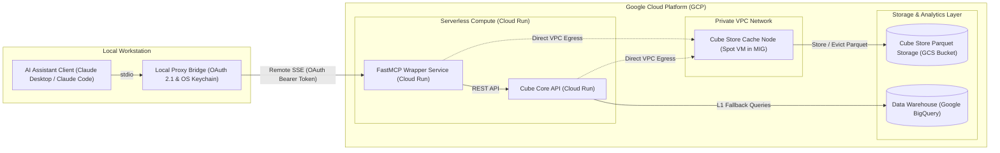

# Cross-Cloud Semantic Layer: Cube Core + FastMCP on GCP

A serverless, cross-cloud plug-and-play semantic layer architecture combining **Cube Core**, **FastMCP**, and **Google Cloud Platform (GCP)** to expose verified dbt metrics to AI agents (Claude Code, Claude Desktop, Cursor, etc.).

---

## 🏛 Architecture Overview



---

## 📁 Repository Structure

```text
cube-core-mcp/
├── README.md                                 # Project overview and quickstart guide
├── docs/
│   ├── semantic_layer_execution_plan.md      # Five-phase end-to-end technical roadmap
│   ├── terraform_setup_and_authentication.md # Local workstation & Terraform setup guide
│   └── terraform_service_account_bootstrap.md # One-time GCP service account bootstrap script
└── terraform/                                # Infrastructure as Code baseline
    ├── .gitignore                            # State and secret protections
    ├── versions.tf                           # Provider & Terraform engine constraints
    ├── backend.tf                            # GCS remote state configuration
    ├── providers.tf                          # HashiCorp Google provider configuration
    ├── variables.tf                          # Input variables and API service definitions
    ├── terraform.tfvars.example              # Template local variables file
    ├── services.tf                           # Declarative GCP API enablement & propagation timers
    └── outputs.tf                            # Output values (project, enabled APIs)
```

---

## 🚀 Quickstart Guide

### 1. Prerequisites
* **Google Cloud Project** with billing enabled.
* **Google Cloud CLI (`gcloud`)** installed and configured ([Installation Guide](docs/terraform_setup_and_authentication.md#b-google-cloud-cli-gcloud-installation)).
* **Terraform** (`>= 1.5.0`) installed ([Installation Guide](docs/terraform_setup_and_authentication.md#a-terraform-installation)).

### 2. Tier 0: Foundation Service Account Bootstrap
Before provisioning infrastructure, create the dedicated deployment service account and assign baseline deployment roles via `gcloud`. Follow the automated 1-minute script in [terraform_service_account_bootstrap.md](docs/terraform_service_account_bootstrap.md):

```bash
# Authenticate your admin account
gcloud auth login

# Run the bootstrap commands outlined in docs/terraform_service_account_bootstrap.md
# to create `terraform-sa` and grant Service Account Token Creator permissions.
```

### 3. Local Workstation Authentication (Keyless ADC)
Generate Application Default Credentials (ADC) by impersonating the newly created service account:

```bash
gcloud auth application-default login \
  --impersonate-service-account="terraform-sa@<YOUR_GCP_PROJECT_ID>.iam.gserviceaccount.com"

# Set quota project
gcloud auth application-default set-quota-project <YOUR_GCP_PROJECT_ID>
```

### 4. Initialize & Deploy Terraform Baseline
Navigate to the `terraform/` directory, configure your variables, and enable GCP APIs:

```bash
cd terraform/

# 1. Create your local variables file
cp terraform.tfvars.example terraform.tfvars
# Edit terraform.tfvars with your GCP project_id and preferred region/zone

# 2. Initialize provider plugins
terraform init

# 3. Review the execution plan (enables 7 baseline GCP APIs + propagation delay)
terraform plan

# 4. Apply the baseline configuration
terraform apply
```

---

## 📚 Documentation Reference Index

* [Semantic Layer Execution Plan](docs/semantic_layer_execution_plan.md) — Comprehensive plan covering:
  * **Phase 1:** Infrastructure as Code (GCS, Spot VM, Cloud Run, VPC Direct Egress).
  * **Phase 2:** Semantic Engine & CI/CD (dbt manifest ingestion & container builds).
  * **Phase 3:** FastMCP Serverless Python Wrapper (OAuth 2.1, REST query translation, SSE).
  * **Phase 4:** Local Client Proxy Bridge (Claude Desktop / Claude Code keychain bridge).
  * **Phase 5:** Plug-and-Play Template Rollout (Cross-project IAM & parameterization).
* [Terraform Setup & Authentication Guide](docs/terraform_setup_and_authentication.md) — Tooling installation, Application Default Credentials, race condition prevention, and provider settings.
* [Terraform Service Account Bootstrap & IAM Strategy](docs/terraform_service_account_bootstrap.md) — Two-tier IAM architecture rationale and automated bootstrap script.
* [Official HashiCorp Google Provider Documentation](https://registry.terraform.io/providers/hashicorp/google/latest/docs) — Up-to-date provider documentation and resource specifications.

---

## 🔒 Security Best Practices
* **No Hardcoded Keys:** Application Default Credentials (ADC) and Service Account impersonation are used exclusively for local development. Static JSON keys are neither generated nor stored.
* **Separation of Concerns:** Deployment credentials (Tier 0) are decoupled from application runtime identities (Tier 1).
* **Controlled API Lifecycle:** All GCP APIs managed through `google_project_service` use `disable_on_destroy = false` to prevent accidental cascading outages.
