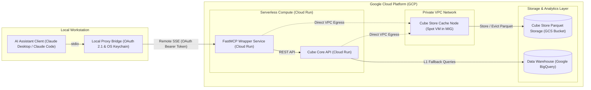

# Cross-Cloud Semantic Layer: Cube Core + FastMCP on GCP

A serverless, cross-cloud plug-and-play semantic layer architecture combining **Cube Core**, **FastMCP**, and **Google Cloud Platform (GCP)** to expose verified dbt metrics to AI agents (Claude Code, Claude Desktop, Cursor, etc.).

---

## Architecture Overview



---

## Repository Structure

```text
cube-core-mcp/
├── README.md                                 # Project overview and quickstart guide
├── AGENT.md                                  # AI agent system prompt and operating parameters
├── docs/
│   ├── bootstrap_terraform_sa.sh             # Automated Tier 0 SA bootstrap script
│   ├── cube_core_architecture_and_gcp_mapping.md # Cube Core engine architecture, GCP mappings, & query lifecycle
│   ├── cube_core_implementation_plan.md      # Five-phase end-to-end technical roadmap
│   ├── terraform_modularization_and_state_migration.md # Modularization rationale & state migration runbook
│   ├── terraform_setup_and_authentication.md # Step-by-step 8-stage initialization runbook
│   ├── terraform_service_account_bootstrap.md # Two-tier IAM architecture and rationale
│   ├── bigquery_setup_and_sample_data.md     # BigQuery architecture, DTS sample ingestion, & prod guide
│   ├── adr_why_cube_store_cannot_run_on_cloud_run.md # ADR: Why Cube Store requires Compute Engine over Cloud Run
│   ├── adr_why_systemd_supervises_cube_store_on_cos.md # ADR: Why systemd supervises Cube Store instead of raw docker run
│   ├── adr_separation_of_dbt_transformations_and_cube_semantic_layer.md # ADR: Separation of dbt transformations and Cube semantic layer
│   ├── cube_core_deployment_guide_review.md  # Official deployment review, BigQuery export mechanics, & env vars
│   ├── cube_core_api_direct_bigquery_guide.md # Tier 4: Direct BigQuery Mode implementation guide
│   ├── gcloud_health_check_runbook.md        # Comprehensive gcloud commands for all active modules
│   └── terraform/                            # Module-specific documentation
│       └── modules/
│           ├── bigquery.md                   # BigQuery dataset & DTS module specification
│           ├── storage.md                    # Cube Store Parquet GCS cache module specification
│           ├── networking.md                 # VPC, subnet, Cloud NAT & firewall specification
│           ├── compute.md                    # Cube Store Spot VM & toggle switch specification
│           └── debug_runbook.md              # Targeted gcloud & bq debugging commands for active modules
└── terraform/                                # Infrastructure as Code baseline
    ├── versions.tf                           # Provider & Terraform engine constraints
    ├── backend.tf                            # Partial GCS remote state configuration
    ├── providers.tf                          # HashiCorp Google provider configuration
    ├── variables.tf                          # Input variables and workload API definitions
    ├── terraform.tfvars.example              # Template local variables file
    ├── services.tf                           # Declarative workload API enablement & propagation timers
    ├── state_bucket.tf                       # GCS remote state bucket definition
    ├── main.tf                               # Top-level child module orchestrator
    ├── outputs.tf                            # Exported attributes and endpoints
    └── modules/                              # Reusable child modules
        ├── bigquery/                         # Datasets, DTS transfer, and DTS service account
        ├── storage/                          # Cube Store GCS cache bucket and workload IAM
        ├── networking/                       # VPC, private subnet, Cloud NAT, and firewall
        └── compute/                          # Cube Store Spot VM (e2-small, 10 GB disk, toggle)
└── src/                                      # Application services and transformation layers
    └── dbt/                                  # Native dbt project transforming thelook_ecommerce
```

---

## Quickstart Guide

For comprehensive walkthroughs, troubleshooting, and official documentation links, refer to [terraform_setup_and_authentication.md](docs/terraform_setup_and_authentication.md).

### 1. Prerequisites & Billing Verification
Ensure your local workstation has `gcloud` and `terraform` (`>= 1.5.0`) installed, and that your target GCP project has an active Cloud Billing account linked:

```bash
# Verify billing status on your target project
gcloud billing projects describe <YOUR_GCP_PROJECT_ID> --format="value(billingEnabled)"
```
*Must return `True` before proceeding.*

### 2. Tier 0: Foundation Service Account Bootstrap
Run the automated bootstrap script [docs/bootstrap_terraform_sa.sh](docs/bootstrap_terraform_sa.sh). It verifies billing, activates core APIs (`serviceusage`, `cloudresourcemanager`, `iam`), provisions the deployment Service Account, and grants keyless impersonation rights:

```bash
gcloud auth login
bash docs/bootstrap_terraform_sa.sh <YOUR_GCP_PROJECT_ID>
```

### 3. Local Workstation Authentication (Keyless ADC)
Generate Application Default Credentials (ADC) by impersonating the newly created service account:

```bash
gcloud auth application-default login \
  --impersonate-service-account="terraform@<YOUR_GCP_PROJECT_ID>.iam.gserviceaccount.com"

gcloud auth application-default set-quota-project <YOUR_GCP_PROJECT_ID>
```

### 4. Configure Variables & Deploy Initial Resources
Navigate to `terraform/`, configure your variable values, and provision the initial state bucket and workload APIs:

```bash
cd terraform/

# 1. Copy template and edit with your project ID and region
cp terraform.tfvars.example terraform.tfvars

# 2. Initialize with local state (backend.tf commented out initially)
terraform init

# 3. Validate and apply initial resources (state bucket + workload APIs)
terraform validate
terraform plan -var-file=terraform.tfvars
terraform apply -var-file=terraform.tfvars
```

### 5. Migrate State to Google Cloud Storage
Once the bucket is provisioned, enable the remote GCS backend in `backend.tf` and migrate local state:

```bash
# 1. Ensure terraform/backend.tf is uncommented:
# terraform {
#   backend "gcs" {
#     prefix = "terraform/state"
#   }
# }

# 2. Migrate local state into GCS
terraform init -backend-config="bucket=<YOUR_GCP_PROJECT_ID>-tfstate" -migrate-state

# 3. Verify state synchronization (should report "No changes")
terraform plan -var-file=terraform.tfvars
```

---

## Documentation Reference Index

* [Cube Core Architecture & GCP Mapping](docs/cube_core_architecture_and_gcp_mapping.md) — Technical breakdown of Cube Core components, GCP resource instantiation, and the end-to-end query evaluation lifecycle.
* [Cube Core Deployment Guide Review](docs/cube_core_deployment_guide_review.md) — Deep dive into official Docker patterns, BigQuery Parquet export mechanics (`CUBEJS_DB_EXPORT_BUCKET`), and environment blueprints.
* [gcloud Health Check Runbook](docs/gcloud_health_check_runbook.md) — Comprehensive copy-pasteable CLI commands to verify, debug, and monitor BigQuery, GCS, VPC, Spot VMs, and Cloud Run.
* [ADR: Why Cube Store Cannot Run on Cloud Run](docs/adr_why_cube_store_cannot_run_on_cloud_run.md) — Analysis of Cloud Run Services, Jobs, and Worker Pools vs. Compute Engine Spot VMs for database caching engines.
* [Cube Core & FastMCP Implementation Plan](docs/cube_core_implementation_plan.md) — Step-by-step 5-tier technical runbook from storage and networking to semantic engine and FastMCP.
* [Terraform Modularization & State Migration](docs/terraform_modularization_and_state_migration.md) — Architectural rationale, directory refactoring, and zero-downtime state pointer migration runbook.
* [Semantic Layer Execution Plan](docs/semantic_layer_execution_plan.md) — Comprehensive plan covering:
  * **Phase 1:** Infrastructure as Code (GCS, Spot VM, Cloud Run, VPC Direct Egress).
  * **Phase 2:** Semantic Engine & CI/CD (dbt manifest ingestion & container builds).
  * **Phase 3:** FastMCP Serverless Python Wrapper (OAuth 2.1, REST query translation, SSE).
  * **Phase 4:** Local Client Proxy Bridge (Claude Desktop / Claude Code keychain bridge).
  * **Phase 5:** Plug-and-Play Template Rollout (Cross-project IAM & parameterization).
* [Terraform Setup & Authentication Guide](docs/terraform_setup_and_authentication.md) — Tooling installation, Application Default Credentials, race condition prevention, and provider settings.
* [Terraform Service Account Bootstrap & IAM Strategy](docs/terraform_service_account_bootstrap.md) — Two-tier IAM architecture rationale and automated bootstrap script.
* [BigQuery Architecture & Sample Data Guide](docs/bigquery_setup_and_sample_data.md) — Public eCommerce sample data ingestion via DTS, IAM resolution, and production transition steps.
* [Official HashiCorp Google Provider Documentation](https://registry.terraform.io/providers/hashicorp/google/latest/docs) — Up-to-date provider documentation and resource specifications.

---

## Security Best Practices
* **No Hardcoded Keys:** Application Default Credentials (ADC) and Service Account impersonation are used exclusively for local development. Static JSON keys are neither generated nor stored.
* **Separation of Concerns:** Deployment credentials (Tier 0) are decoupled from application runtime identities (Tier 1).
* **Controlled API Lifecycle:** All GCP APIs managed through `google_project_service` use `disable_on_destroy = false` to prevent accidental cascading outages.
