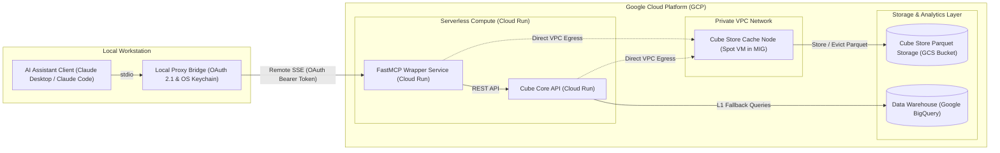

# Cross-Cloud Semantic Layer: Cube Core + FastMCP on GCP

A serverless, cross-cloud plug-and-play semantic layer architecture combining **Cube Core**, **FastMCP**, and **Google Cloud Platform (GCP)** to expose verified dbt metrics to AI agents (Claude Code, Claude Desktop, Cursor, etc.).

---

## Architecture Overview



---

## Repository Structure

```text
cube-core-mcp/
├── README.md                                 # Project overview and quickstart guide
├── AGENT.md                                  # AI agent system prompt and operating parameters
├── docs/                                     # Structured documentation (Diátaxis Framework)
│   ├── README.md                             # Master documentation catalog
│   ├── architecture/                         # Architecture, C4 views, and Decision Records
│   │   ├── c4_architecture_and_design_context.md # Level 1-4 C4 models, trade-offs, and workarounds
│   │   └── adrs/                             # Architecture Decision Records (ADRs 0001 - 0007)
│   ├── guides/                               # Learning tutorials and getting started
│   │   ├── plug_and_play_installation_guide.md # Complete end-to-end deployment runbook
│   │   ├── terraform_setup_and_authentication.md # Workstation ADC and state lifecycle
│   │   ├── fastmcp_local_testing_and_verification.md # Local testing and inspection
│   │   └── bigquery_setup_and_sample_data.md # Sample data ingestion and warehouse setup
│   ├── operations/                           # Operational and troubleshooting runbooks
│   │   ├── cloud_run_troubleshooting_and_error_runbook.md # Deployment error resolution
│   │   ├── gcloud_health_check_runbook.md    # CLI monitoring and health verification
│   │   └── bootstrap_terraform_sa.sh         # Tier 0 SA bootstrap automation
│   ├── reference/                            # Technical specifications and API references
│   │   ├── terraform_modules.md              # Child module inputs, outputs, and dependencies
│   │   ├── fastmcp_api_and_tools.md          # MCP tool contracts, schemas, and OAuth specs
│   │   └── cube_core_modeling_and_config.md  # YAML modeling, Jinja filters, and env vars
│   └── backlog/                              # Project roadmaps and technical debt
│       ├── execution_plan.md                 # Five-phase technical delivery roadmap
│       ├── project_wide_debt.md              # Technical debt items and improvement plan
│       └── todo_list.md                      # Open backlog tasks
└── terraform/                                # Infrastructure as Code baseline
    ├── versions.tf                           # Provider & Terraform engine constraints
    ├── backend.tf                            # Partial GCS remote state configuration
    ├── providers.tf                          # HashiCorp Google provider configuration
    ├── variables.tf                          # Input variables and workload API definitions
    ├── terraform.tfvars.example              # Template local variables file
    ├── services.tf                           # Declarative workload API enablement & propagation timers
    ├── state_bucket.tf                       # GCS remote state bucket definition
    ├── main.tf                               # Top-level child module orchestrator
    ├── outputs.tf                            # Exported attributes and endpoints
    └── modules/                              # Reusable child modules
        ├── bigquery/                         # Datasets, DTS transfer, and DTS service account
        ├── storage/                          # Cube Store GCS cache bucket and workload IAM
        ├── networking/                       # VPC, private subnet, Cloud NAT, and firewall
        ├── compute/                          # Cube Store Spot VM (e2-small, 10 GB disk, toggle)
        └── cloud_run/                        # Cloud Run v2 Cube API, Artifact Registry & IAM
└── src/                                      # Application services and transformation layers
    ├── dbt/                                  # Native dbt project transforming thelook_ecommerce
    └── cube/                                 # Lean Cube Core container with declarative YAML models
```

---

## Quickstart Guide

For comprehensive walkthroughs, troubleshooting, and official documentation links, refer to the [Plug-and-Play Installation Guide](docs/guides/plug_and_play_installation_guide.md) or [Terraform Setup Guide](docs/guides/terraform_setup_and_authentication.md).

### 1. Prerequisites & Billing Verification
Ensure your local workstation has `gcloud` and `terraform` (`>= 1.5.0`) installed, and that your target GCP project has an active Cloud Billing account linked:

```bash
# Verify billing status on your target project
gcloud billing projects describe <YOUR_GCP_PROJECT_ID> --format="value(billingEnabled)"
```
*Must return `True` before proceeding.*

### 2. Tier 0: Foundation Service Account Bootstrap
Run the automated bootstrap script [docs/bootstrap_terraform_sa.sh](docs/bootstrap_terraform_sa.sh). It verifies billing, activates core APIs (`serviceusage`, `cloudresourcemanager`, `iam`), provisions the deployment Service Account, and grants keyless impersonation rights:

```bash
gcloud auth login
bash docs/bootstrap_terraform_sa.sh <YOUR_GCP_PROJECT_ID>
```

### 3. Local Workstation Authentication (Keyless ADC)
Generate Application Default Credentials (ADC) by impersonating the newly created service account:

```bash
gcloud auth application-default login \
  --impersonate-service-account="terraform@<YOUR_GCP_PROJECT_ID>.iam.gserviceaccount.com"

gcloud auth application-default set-quota-project <YOUR_GCP_PROJECT_ID>
```

### 4. Configure Variables & Deploy Initial Resources
Navigate to `terraform/`, configure your variable values, and provision the initial state bucket and workload APIs:

```bash
cd terraform/

# 1. Copy template and edit with your project ID and region
cp terraform.tfvars.example terraform.tfvars

# 2. Initialize with local state (backend.tf commented out initially)
terraform init

# 3. Validate and apply initial resources (state bucket + workload APIs)
terraform validate
terraform plan -var-file=terraform.tfvars
terraform apply -var-file=terraform.tfvars
```

### 5. Migrate State to Google Cloud Storage
Once the bucket is provisioned, enable the remote GCS backend in `backend.tf` and migrate local state:

```bash
# 1. Ensure terraform/backend.tf is uncommented:
# terraform {
#   backend "gcs" {
#     prefix = "terraform/state"
#   }
# }

# 2. Migrate local state into GCS
terraform init -backend-config="bucket=<YOUR_GCP_PROJECT_ID>-tfstate" -migrate-state

# 3. Verify state synchronization (should report "No changes")
terraform plan -var-file=terraform.tfvars
```

---

## Documentation Catalog (Diátaxis Framework)

For the complete catalog, consult [docs/README.md](docs/README.md).

### 1. Tutorials & Getting Started
* [End-to-End Plug-and-Play Installation Guide](docs/guides/plug_and_play_installation_guide.md) — Step-by-step onboarding from bootstrap to Claude Web/Desktop/Code connection.
* [Terraform Setup & Authentication Guide](docs/guides/terraform_setup_and_authentication.md) — Tooling installation, Application Default Credentials, and remote state migration.
* [BigQuery Architecture & Sample Data Guide](docs/guides/bigquery_setup_and_sample_data.md) — Public eCommerce sample data ingestion via DTS and production transition.

### 2. Architecture, C4 Models & Decision Records
* [C4 Architecture & Design Context](docs/architecture/c4_architecture_and_design_context.md) — Level 1-4 C4 models, architectural trade-offs, dependencies, and temporary workarounds.
* [Architecture Decision Records (ADRs)](docs/architecture/adrs/README.md) — ADRs 0001 through 0007 documenting key architectural choices.

### 3. Operational Runbooks & Troubleshooting
* [Cloud Run Troubleshooting & Error Runbook](docs/operations/cloud_run_troubleshooting_and_error_runbook.md) — Common deployment errors, startup failures, and remediation procedures.
* [gcloud Health Check Runbook](docs/operations/gcloud_health_check_runbook.md) — Copy-pasteable CLI commands to monitor BigQuery, GCS, Spot VMs, and Cloud Run.
* [FastMCP Local Testing & Verification](docs/guides/fastmcp_local_testing_and_verification.md) — Local testing, CLI tool invocation, and interactive Dev UI.

### 4. Technical Reference
* [Terraform Modules Reference](docs/reference/terraform_modules.md) — Inputs, outputs, and dependencies for all child modules.
* [FastMCP Analytical Tools & API Reference](docs/reference/fastmcp_api_and_tools.md) — Tool schemas, Google OAuth 2.0 specs, and response formats.
* [Cube Core Modeling & Configuration Reference](docs/reference/cube_core_modeling_and_config.md) — YAML modeling syntax, dynamic table prefixing, and environment variables.

---

## Security Best Practices
* **No Hardcoded Keys:** Application Default Credentials (ADC) and Service Account impersonation are used exclusively for local development. Static JSON keys are neither generated nor stored.
* **Separation of Concerns:** Deployment credentials (Tier 0) are decoupled from application runtime identities (Tier 1).
* **Controlled API Lifecycle:** All GCP APIs managed through `google_project_service` use `disable_on_destroy = false` to prevent accidental cascading outages.
