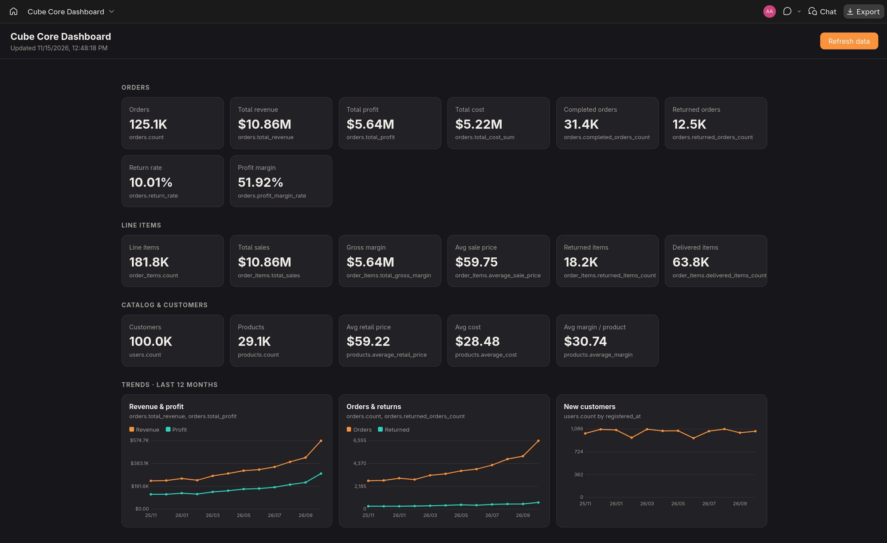
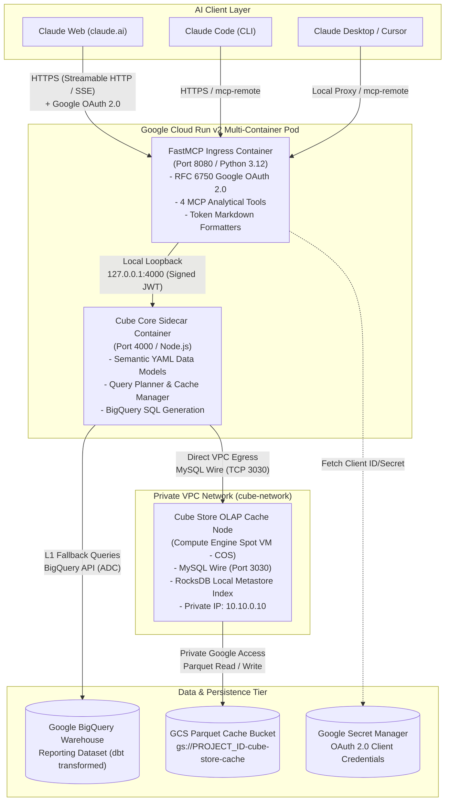

# Cross-Cloud Semantic Layer: Cube Core + FastMCP on GCP

[](https://www.terraform.io)
[](https://cloud.google.com)
[](https://cube.dev)
[](https://github.com/jlowin/fastmcp)
[](https://modelcontextprotocol.io)
[](#security-best-practices)

A production-grade, serverless semantic layer architecture combining **Cube Core**, **FastMCP**, and **Google Cloud Platform (GCP)** to expose governed BigQuery data warehouse metrics to autonomous AI agents (**Claude Web**, **Claude Code CLI**, **Claude Desktop**, and **Cursor IDE**) via the **Model Context Protocol (MCP)**.

---

## Semantic Metrics in Action

The architecture bridges analytical data warehousing with real-time AI context by compiling complex dimensional models, joins, calculated measures, and rollup pre-aggregations into a centralized semantic engine:



*Unified semantic dashboard tracking gross merchandise value, profit margins, return rates, line-item economics, and customer trends—accelerated via Cube Store OLAP caching with sub-second response times.*

---

## Core Capabilities & Engineering Highlights

* **Sub-Second Analytical Latency:** Multi-tier caching combines Cube Core L1 in-memory query cache with Cube Store L2 columnar pre-aggregations persisted in Google Cloud Storage as partitioned Apache Parquet chunks.
* **Governed Metric Consistency:** Centralizes business logic (Gross Merchandise Value, profit margin ratios, return rates) so AI assistants always report identical, mathematically verified numbers.
* **Enterprise Google OAuth 2.0 (RFC 6750):** Native support for OAuth 2.0 Protected Resource Metadata (`/.well-known/oauth-protected-resource/mcp`), enabling one-click interactive browser authentication in Claude.ai.
* **Plug-and-Play Warehouse Federation:** Operates seamlessly across single-project mode and cross-project enterprise warehouses using dynamic Jinja `| safe` table prefixing without altering semantic schemas.
* **Token Budget Optimization:** Custom Python formatters convert multi-megabyte raw JSON database responses into compact, token-efficient Markdown tables, reducing LLM context window consumption by 70–85%.
* **Zero-Cost Resting State:** Infrastructure can be toggled into a dormant resting state (`~$0.00/month`) with zero hourly NAT or compute fees, scaling to active serving on demand.
* **Keyless Security Model:** Strictly eliminates static Service Account JSON keys; enforces Application Default Credentials (ADC) with IAM role impersonation.

---

## Architecture Topology

The deployment packages FastMCP and Cube Core into a high-performance **Cloud Run v2 Multi-Container Pod**, communicating over local loopback (`127.0.0.1`) and routing private cache queries to an ephemeral Spot VM over Direct VPC Egress:



---

## Governed AI Analytical Tools

When connected over MCP, AI assistants receive access to 4 governed semantic tools:

| Tool Name | Operation & Purpose | Cache Routing | Response Format |
| :--- | :--- | :--- | :--- |
| **`get_metadata()`** | Schema discovery: returns all defined cubes, dimensions, measures, and pre-aggregations. | In-Memory Catalog | Token-efficient Markdown schema catalog |
| **`run_semantic_query()`** | Executes governed metric queries with dimensions, filters, time ranges, and limits. | L1 Memory $\rightarrow$ L2 Cube Store $\rightarrow$ BigQuery | Compact Markdown table + cache source metadata |
| **`run_sql_query()`** | Executes ad-hoc or exploratory SQL queries via Cube's SQL API with warehouse pushdown. | Cube SQL Compiler $\rightarrow$ BigQuery | Tabular Markdown result + column definitions |
| **`explain_sql_query()`** | Generates compiled BigQuery SQL and cache execution plans without running queries. | Query Planner Inspection | Formatted execution plan + raw BigQuery SQL |

---

## Client Integration Guide

### 1. Claude Web (claude.ai)
1. In Claude Web, navigate to **Settings > Integrations > MCP Servers > Add Custom MCP Server**.
2. **Name:** `Cube Semantic Layer`
3. **URL:** `https://<YOUR-CLOUD-RUN-SERVICE-URL>/mcp`
4. Click **Connect** and authorize access via the Google OAuth popup window.

### 2. Claude Code CLI
```bash
claude mcp add cube-semantic-layer -- npx -y mcp-remote https://<YOUR-CLOUD-RUN-SERVICE-URL>/mcp
```

### 3. Claude Desktop
Add to your `claude_desktop_config.json`:
```json
{
  "mcpServers": {
    "cube-semantic-layer": {
      "command": "npx",
      "args": [
        "-y",
        "mcp-remote",
        "https://<YOUR-CLOUD-RUN-SERVICE-URL>/mcp"
      ]
    }
  }
}
```

### 4. Cursor IDE
1. Open **Cursor Settings > Features > MCP > Add New MCP Server**.
2. Set Name: `cube-semantic-layer`, Type: `command`, Command: `npx -y mcp-remote https://<YOUR-CLOUD-RUN-SERVICE-URL>/mcp`.

---

## Repository Structure

```text
cube-core-mcp/
├── README.md                                 # Project overview and quickstart guide
├── AGENT.md                                  # AI agent system prompt and operating rules
├── docs/                                     # Structured documentation (Diátaxis Framework)
│   ├── README.md                             # Master documentation catalog
│   ├── architecture/                         # Architecture, C4 views, and Decision Records
│   │   ├── c4_architecture_and_design_context.md # Level 1-4 C4 models, trade-offs, and workarounds
│   │   └── adrs/                             # Architecture Decision Records (ADRs 0001 - 0007)
│   ├── guides/                               # Learning tutorials and getting started
│   │   ├── plug_and_play_installation_guide.md # Complete end-to-end deployment runbook
│   │   ├── terraform_setup_and_authentication.md # Workstation ADC and state lifecycle
│   │   ├── fastmcp_local_testing_and_verification.md # Local testing and inspection
│   │   └── bigquery_setup_and_sample_data.md # Sample data ingestion and warehouse setup
│   ├── operations/                           # Operational and troubleshooting runbooks
│   │   ├── cloud_run_troubleshooting_and_error_runbook.md # Deployment error resolution
│   │   ├── gcloud_health_check_runbook.md    # CLI monitoring and health verification
│   │   └── bootstrap_terraform_sa.sh         # Tier 0 SA bootstrap automation
│   ├── reference/                            # Technical specifications and API references
│   │   ├── terraform_modules.md              # Child module inputs, outputs, and dependencies
│   │   ├── fastmcp_api_and_tools.md          # MCP tool contracts, schemas, and OAuth specs
│   │   └── cube_core_modeling_and_config.md  # YAML modeling, Jinja filters, and env vars
│   └── backlog/                              # Project roadmaps and technical debt
│       ├── execution_plan.md                 # Five-phase technical delivery roadmap
│       ├── project_wide_debt.md              # Technical debt items and improvement plan
│       └── todo_list.md                      # Open backlog tasks
├── terraform/                                # Declarative infrastructure as code
│   ├── versions.tf                           # Engine & provider version constraints
│   ├── backend.tf                            # Partial GCS remote state configuration
│   ├── providers.tf                          # HashiCorp Google provider configuration
│   ├── variables.tf                          # Strongly typed input variables
│   ├── terraform.tfvars.example              # Environment configuration template
│   ├── services.tf                           # Declarative workload API enablement & timers
│   ├── state_bucket.tf                       # GCS remote state bucket definition
│   ├── main.tf                               # Child module orchestration
│   ├── outputs.tf                            # Exported attributes and endpoints
│   └── modules/                              # Reusable child modules
│       ├── bigquery/                         # Datasets, DTS transfer, and DTS service account
│       ├── storage/                          # Cube Store GCS cache bucket and workload IAM
│       ├── networking/                       # VPC, private subnet, and firewall rules
│       ├── compute/                          # Cube Store Spot VM with systemd cloud-init
│       └── cloud_run/                        # Multi-container Cloud Run v2 service & Artifact Registry
└── src/                                      # Application services and transformation layers
    ├── dbt/                                  # dbt project transforming thelook_ecommerce
    ├── cube/                                 # Cube Core container & declarative YAML models
    ├── cube_store/                           # Cloud Build configuration for container mirroring
    └── fastmcp/                              # FastMCP Python serving wrapper & OAuth engine
```

---

## Quickstart Deployment Runbook

For exhaustive step-by-step instructions, troubleshooting runbooks, and cross-project IAM guides, consult the [End-to-End Plug-and-Play Installation Guide](docs/guides/plug_and_play_installation_guide.md).

### 1. Prerequisites
Ensure your local machine has `gcloud` and `terraform` (`>= 1.5.0`) installed, and that your target GCP project has billing enabled:
```bash
gcloud billing projects describe <YOUR_GCP_PROJECT_ID> --format="value(billingEnabled)"
```

### 2. Tier 0: Foundation Service Account Bootstrap
Execute the automated bootstrap script to provision the deployment service account, grant least-privilege IAM roles, and configure keyless impersonation:
```bash
gcloud auth login
chmod +x docs/operations/bootstrap_terraform_sa.sh
./docs/operations/bootstrap_terraform_sa.sh <YOUR_GCP_PROJECT_ID>
```

### 3. Local Workstation Impersonation (Keyless ADC)
Generate Application Default Credentials (ADC) without creating static JSON keys:
```bash
gcloud auth application-default login \
  --impersonate-service-account="terraform@<YOUR_GCP_PROJECT_ID>.iam.gserviceaccount.com"

gcloud auth application-default set-quota-project <YOUR_GCP_PROJECT_ID>
```

### 4. Build and Mirror Containers
Mirror Cube Store into Artifact Registry (eliminates Cloud NAT costs) and build the serving images:
```bash
# 1. Mirror Cube Store container via Cloud Build
gcloud builds submit src/cube_store \
  --project="<YOUR_GCP_PROJECT_ID>" \
  --config=src/cube_store/cloudbuild.yaml

# 2. Build Cube Core container
gcloud builds submit src/cube \
  --project="<YOUR_GCP_PROJECT_ID>" \
  --tag="asia-south1-docker.pkg.dev/<YOUR_GCP_PROJECT_ID>/cube-repo/cube-api:latest"

# 3. Build FastMCP container
gcloud builds submit src/fastmcp \
  --project="<YOUR_GCP_PROJECT_ID>" \
  --tag="asia-south1-docker.pkg.dev/<YOUR_GCP_PROJECT_ID>/cube-repo/fastmcp-api:latest"
```

### 5. Provision Infrastructure via Terraform
```bash
cd terraform/
cp terraform.tfvars.example terraform.tfvars
# Configure your project_id, reporting_project_id, and feature flags in terraform.tfvars

# Initialize remote state backend and apply
terraform init -backend-config="bucket=<YOUR_GCP_PROJECT_ID>-tfstate"
terraform validate
terraform plan -var-file=terraform.tfvars
terraform apply -var-file=terraform.tfvars
```

---

## Documentation Catalog (Diátaxis Framework)

For the master documentation index, refer to [docs/README.md](docs/README.md).

### 1. Tutorials & Guides
* [Plug-and-Play Installation Guide](docs/guides/plug_and_play_installation_guide.md) — Complete setup guide from project bootstrap to AI client connection.
* [Terraform Setup & Authentication Guide](docs/guides/terraform_setup_and_authentication.md) — Workstation tooling, keyless ADC, and state lifecycle.
* [BigQuery Architecture & Sample Data Guide](docs/guides/bigquery_setup_and_sample_data.md) — Public eCommerce sample data ingestion and schema setup.

### 2. Architecture, C4 Models & Decision Records
* [C4 Architecture & Design Context](docs/architecture/c4_architecture_and_design_context.md) — System Context (L1), Containers (L2), Components (L3), Query Lifecycle (L4), and trade-offs.
* [Production Readiness Audit & Hardening Roadmap](docs/architecture/production_readiness_audit.md) — Exhaustive review of security vulnerabilities, reliability single-points-of-failure, and remediation steps.
* [Architecture Decision Records (ADRs)](docs/architecture/adrs/README.md) — Individual records (ADR 0001 through 0007) documenting key architectural choices.

### 3. Operational Runbooks & Troubleshooting
* [Cloud Run Troubleshooting Runbook](docs/operations/cloud_run_troubleshooting_and_error_runbook.md) — Resolution procedures for container startup, Jinja escaping, and IAM errors.
* [gcloud Health Check Runbook](docs/operations/gcloud_health_check_runbook.md) — Copy-pasteable CLI commands to inspect BigQuery, GCS, Spot VMs, and Cloud Run.
* [FastMCP Local Testing & Verification](docs/guides/fastmcp_local_testing_and_verification.md) — Local testing, CLI tool invocation, and interactive Dev UI.

### 4. Technical Reference
* [Terraform Modules Reference](docs/reference/terraform_modules.md) — Child module inputs, outputs, and dependencies.
* [FastMCP Analytical Tools Reference](docs/reference/fastmcp_api_and_tools.md) — Tool schemas, Google OAuth 2.0 specs, and response formats.
* [Cube Core Modeling Reference](docs/reference/cube_core_modeling_and_config.md) — YAML modeling syntax, dynamic table prefixing, and environment variables.

---

## Security Best Practices

* **No Hardcoded Keys:** Application Default Credentials (ADC) and Service Account impersonation are enforced across all operations. Static JSON keys are neither generated nor stored.
* **Separation of Concerns:** Tier 0 deployment credentials are strictly decoupled from Tier 1 application runtime identities.
* **Network Isolation:** The Compute Engine Spot VM runs with **zero public IP addresses**, pulling images and persisting Parquet data via **Private Google Access**.
* **Protected Ingress:** External ingress is restricted to FastMCP over HTTPS, secured with RFC 6750 Google OAuth 2.0 token validation.
* **Controlled API Lifecycle:** All GCP APIs managed through `google_project_service` use `disable_on_destroy = false` to prevent accidental cascading outages.

---

## Project Roadmap & TODO

The following enhancements and technical debt items are tracked across [docs/backlog/todo_list.md](docs/backlog/todo_list.md) and [docs/backlog/project_wide_debt.md](docs/backlog/project_wide_debt.md):

### 1. Infrastructure & High Availability
- [ ] **Spot VM Managed Instance Group (MIG):** Refactor `terraform/modules/compute` from a standalone instance into a zonal Managed Instance Group (target size 1) with auto-healing and health checks to automatically recover when preempted by GCP.
- [ ] **GCS State Bucket Lifecycle Policy:** Add an automatic object lifecycle retention rule in `terraform/state_bucket.tf` to expire noncurrent state versions older than 30 days while preserving the 5 most recent versions.
- [ ] **Configurable Persistent Disk Types:** Expose `pd-balanced` or `pd-ssd` disk types as variables in the compute module to accelerate RocksDB metastore I/O operations.

### 2. CI/CD & Developer Tooling
- [ ] **Automated GitHub Actions CI/CD:** Establish a pull-request pipeline using Workload Identity Federation (WIF) executing `terraform fmt -check`, `validate`, `tflint`, and speculative plan diffs without static service account keys.
- [ ] **Automated Semantic Image Publishing:** Create a GitHub Actions workflow triggered on model changes in `src/cube/model/` to build, tag, and publish `cube-api:latest` to Artifact Registry.
- [ ] **Developer Ergonomics (`Makefile`):** Add a root `Makefile` wrapping routine developer workflows (`make auth`, `make init`, `make plan`, `make apply`, `make test`, `make fmt`, `make validate`).
- [ ] **Pre-commit Hooks & Static Analysis:** Configure `.pre-commit-config.yaml` with `detect-secrets` and `.tflint.hcl` with Google ruleset plugins.

### 3. Semantic Layer & Agent Skills
- [ ] **Skill for Metric Auto-Generation:** Develop an agent skill to inspect target dbt models and automatically draft corresponding business measures.
- [ ] **dbt-to-Cube Conversion Skill:** Develop an agent skill to translate dbt semantic models into Cube Core declarative YAML definitions.
- [ ] **Pre-aggregation Partitioning & Refresh Keys:** Define explicit partition bounds and scheduled `refresh_key` settings on rollups to automate cache invalidation and reduce BigQuery scan costs.

### 4. Client Connectivity & Security
- [ ] **Dedicated Local Client Proxy Bridge (`src/bridge`):** Build a dedicated Python stdio-to-SSE bridge utilizing local OS keychain integration (`keyring`) for silent, background OAuth refresh token exchange.
- [ ] **Token Budget Guards & Pagination:** Enhance FastMCP formatters with configurable token limits and pagination controls to prevent context window saturation on wide analytical queries.

