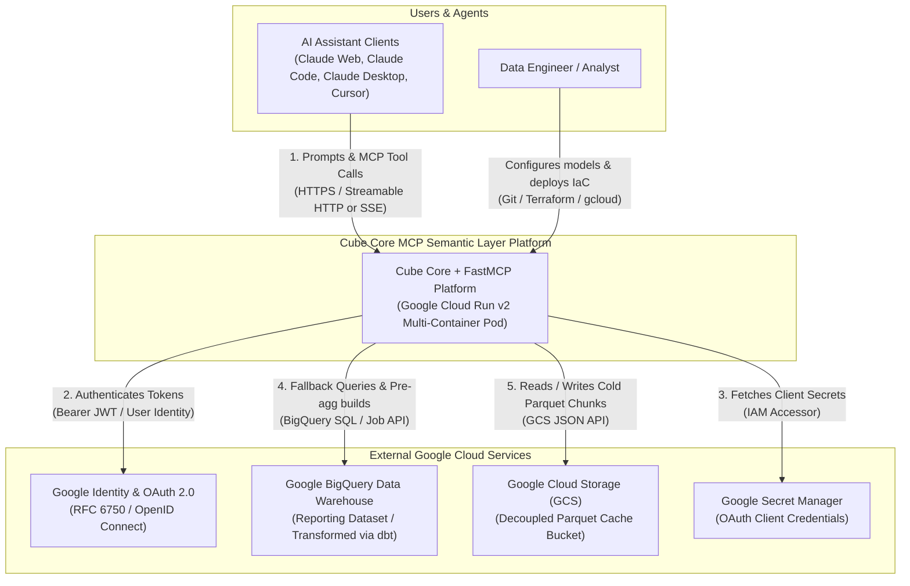
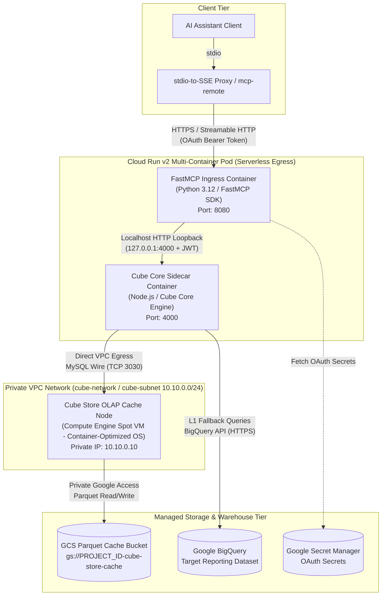
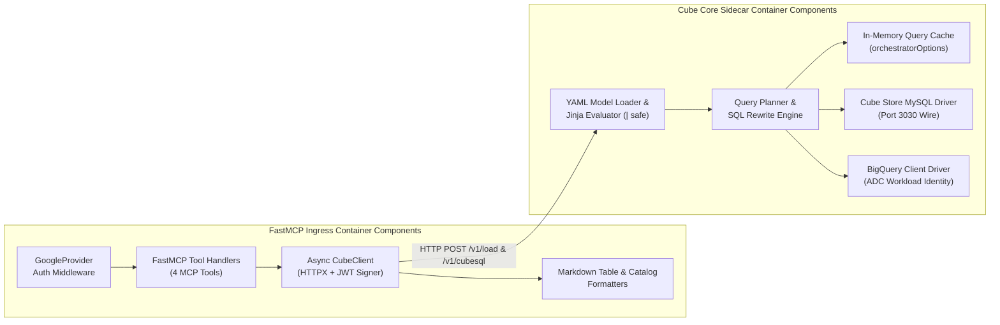
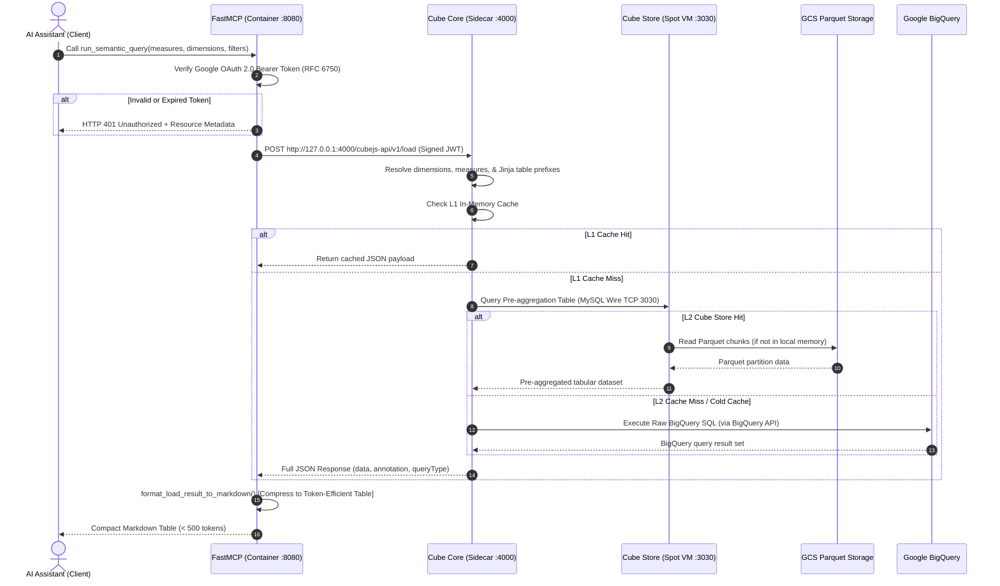

# Architecture & Design Context: C4 Model, Trade-offs & Operational Blueprint

This document provides the foundational architectural and design context for the **Cube Core + FastMCP Semantic Layer on Google Cloud Platform (GCP)**. It articulates not only what is deployed, but *why* specific engineering decisions were made—detailing architectural trade-offs, evaluated alternatives, external dependencies, security boundaries, and temporary workarounds.

The architectural views follow the **C4 Model** (Context, Containers, Components, and Code/Data Flow) to provide appropriate abstractions across diverse stakeholder audiences.

---

## 1. System Vision & Problem Statement

Modern enterprise data architectures face a widening impedance mismatch:
1. **The Warehouse Reality:** Data warehouses (Google BigQuery) store petabytes of dimensionally modeled tables (via dbt) optimized for columnar scans, partition pruning, and batch analytical jobs.
2. **The AI Assistant Need:** Autonomous AI agents (Claude Web, Claude Code CLI, Claude Desktop, Cursor) require rapid, sub-second responses, strict semantic consistency (guaranteeing that "Gross Margin" is computed identically across all queries), token-efficient responses, and standard protocol integrations via the **Model Context Protocol (MCP)**.
3. **The Cost & Performance Gap:** Allowing an LLM to generate raw BigQuery SQL directly causes high warehouse scanning costs, risk of catastrophic table scans, and hallucinated table joins or measure definitions.

**The Solution:** A serverless, plug-and-play semantic layer architecture coupling **Cube Core** (semantic models, metric governance, L1 in-memory caching, L2 columnar pre-aggregations) and **FastMCP** (MCP protocol translation, Google OAuth 2.0 validation, token-optimized Markdown formatting) hosted on **Cloud Run v2**, supported by decoupled **Cube Store** OLAP caching on Compute Engine Spot VMs and Google Cloud Storage.

---

## 2. C4 Model: Architectural Views

### 2.1 Level 1: System Context Diagram

The System Context view illustrates the boundary of the Semantic Layer platform, showing how end users and AI client interfaces interact with it, and its dependencies on external Google Cloud enterprise services.



#### Actor and System Catalog
* **AI Assistant Clients:** Consumer applications communicating over the Model Context Protocol to execute governed queries and retrieve data catalogs.
* **Cube Core MCP Platform:** The unified semantic engine exposing tools (`get_metadata`, `run_semantic_query`, `run_sql_query`, `explain_sql_query`).
* **Google BigQuery:** Source of truth data warehouse. Can be co-located in the same GCP project (Single-Project Mode) or residing in an enterprise-wide warehouse project (Cross-Project Mode).
* **Google Cloud Storage:** Persistent, durable object tier storing pre-aggregated columnar data in Apache Parquet format.
* **Google Identity / Secret Manager:** Secures ingress tool execution through OAuth 2.0 token verification and encrypted credential retrieval.

---

### 2.2 Level 2: Container Diagram

The Container diagram zooms into the platform boundary to show the high-level deployable units, runtime environments, storage systems, and networking channels.



#### Container Responsibilities
1. **FastMCP Ingress Container (Port 8080):**
   * Acts as the single entrypoint exposed to the internet.
   * Enforces RFC 6750 Google OAuth 2.0 Bearer authentication.
   * Maps natural language LLM tool arguments into strict Cube REST and SQL queries.
   * Formats verbose JSON payloads into token-compressed Markdown tables.
2. **Cube Core Sidecar Container (Port 4000):**
   * Evaluates semantic YAML schemas, dimensions, measures, and join relationships.
   * Generates optimized BigQuery SQL dialect.
   * Manages L1 in-memory query cache and determines L2 Cube Store routing.
   * Communicates privately with FastMCP over local loopback (`127.0.0.1`), eliminating inter-service network latency and serialization costs.
3. **Cube Store Cache Node (Spot VM, Private IP 10.10.0.10):**
   * Ephemeral, high-speed columnar caching engine written in Rust.
   * Maintains RocksDB metadata index locally and persists pre-aggregated table partitions in GCS.
   * Listens on internal MySQL wire protocol (port 3030) and cluster gossip (port 9999).
   * Operates with **zero public IP**, reaching GCS via Private Google Access.

---

### 2.3 Level 3: Component Diagram

The Component diagram reveals the internal structural composition of the primary runtime containers.



---

### 2.4 Level 4: Code & Query Evaluation Lifecycle

The sequence diagram details the end-to-end execution lifecycle of an analytical query initiated by an AI assistant:



---

## 3. Architectural Trade-offs & Alternatives Considered

Every architectural layer was selected based on explicit engineering trade-offs regarding cost, operational overhead, resilience, and performance.

| Decision Area | Selected Pattern | Alternatives Evaluated | Rationale & Trade-offs | Relevant ADR |
| :--- | :--- | :--- | :--- | :--- |
| **Compute Packaging** | Multi-Container Cloud Run v2 Pod | 1. Separate Cloud Run Services<br/>2. Google Kubernetes Engine (GKE)<br/>3. Compute Engine VMs | Multi-container co-locates FastMCP and Cube Core on localhost (`127.0.0.1`), eliminating inter-service network hops, internal Cloud Run invoker authentication overhead, and redundant VPC egress connectors. GKE introduces excessive cluster baseline costs (~$72/mo minimum). | [ADR-004](file:///home/angelo/projects/cube-core-mcp/docs/architecture/adrs/0004_multi_container_pod_vs_separate_services.md) |
| **OLAP Cache Engine** | Compute Engine Spot VM (Container-Optimized OS) | 1. Cloud Run Service<br/>2. Cloud Run Job<br/>3. Cloud Memorystore (Redis) | Cube Store requires an unevictable local disk for RocksDB metadata, multi-threaded background compaction workers, and continuous MySQL wire listening (port 3030). Cloud Run terminates background CPU threads outside requests and lacks persistent local POSIX disks. Redis is in-memory only and cannot execute columnar aggregate pushdown on Parquet. | [ADR-001](file:///home/angelo/projects/cube-core-mcp/docs/architecture/adrs/0001_why_cube_store_cannot_run_on_cloud_run.md) |
| **Process Supervision** | Cloud-Init `systemd` Unit on COS | 1. Raw `docker run` in startup script<br/>2. Google Cloud VM Instance Metadata container declaration | `systemd` guarantees automated crash restarts, injects base64 service account keys with strict `0600` permissions before Docker startup, and structures logging directly into `journald` and Cloud Logging. Raw `docker run` fails silently on container crashes. | [ADR-002](file:///home/angelo/projects/cube-core-mcp/docs/architecture/adrs/0002_why_systemd_supervises_cube_store_on_cos.md) |
| **Networking & Egress** | Direct VPC Egress (Private Ranges Only) | 1. Serverless VPC Access Connector<br/>2. Public IP with Firewall Rules | Direct VPC Egress is native to Cloud Run v2, incurs zero connector VM baseline fees (~$18/mo savings), and provides sub-millisecond latency to the Spot VM private IP. Restricting to `PRIVATE_RANGES_ONLY` keeps Google API traffic (BigQuery, GCS, Logging) on Google's optimized internal backbone. | [terraform/modules/cloud_run.md](file:///home/angelo/projects/cube-core-mcp/docs/terraform/modules/cloud_run.md) |
| **Outbound Image Pulls** | Artifact Registry Private Mirroring | 1. Cloud NAT Gateway on VPC Subnet<br/>2. External Public IP on Spot VM | Pulling images from Docker Hub via Cloud NAT incurs continuous hourly gateway fees (~$32.40/mo). Mirroring upstream images into Artifact Registry allows the Spot VM to pull images over Private Google Access with zero NAT and zero external IP. | [ADR-005](file:///home/angelo/projects/cube-core-mcp/docs/architecture/adrs/0005_artifact_registry_mirroring_vs_cloud_nat.md) |
| **Warehouse Federation** | Dynamic Jinja `\| safe` Table Prefixing | 1. Duplicate Cube schema files per environment<br/>2. Hardcoded project IDs in SQL models | Jinja dynamic prefixing evaluates `CUBEJS_REPORTING_TABLE_PREFIX` at runtime. In Single-Project Mode, it points to local `analytics.fct_orders`. In Cross-Project Mode, it interpolates `` `enterprise-data-prod`.analytics.fct_orders `` without modifying a single line of schema code. | [ADR-006](file:///home/angelo/projects/cube-core-mcp/docs/architecture/adrs/0006_jinja_safe_cross_project_bigquery_federation.md) |
| **Data Transformation Separation** | ELT (dbt) decoupled from Semantic Serving (Cube) | 1. dbt Semantic Layer exclusively<br/>2. SQL Views in BigQuery without Cube | dbt excels at batch, dependency-graphed data transformation in warehouse tables. Cube specializes in real-time query compilation, multidimensional caching, and interactive LLM tool servicing. Separating them prevents lock-in and warehouse query exhaustion. | [ADR-003](file:///home/angelo/projects/cube-core-mcp/docs/architecture/adrs/0003_separation_of_dbt_transformations_and_cube_semantic_layer.md) |
| **LLM Payload Optimization** | Token-Efficient Markdown Tables | 1. Raw JSON Payloads<br/>2. CSV string streaming | Raw JSON responses from Cube include deep metadata structures (annotations, time dimensions, query descriptors) that consume thousands of LLM context tokens. Formatters strip verbose schema envelopes and render dense Markdown tables, reducing token consumption by 70-85%. | [src/fastmcp/src/cube_fastmcp/formatters.py](file:///home/angelo/projects/cube-core-mcp/src/fastmcp/src/cube_fastmcp/formatters.py) |

---

## 4. Dependencies, Security Boundaries & Runtime Identities

### 4.1 Two-Tier IAM & Security Model

The system enforces a strict separation between **Deployment Credentials (Tier 0)** and **Runtime Identities (Tier 1)**:

```
[ Local Engineer / CI/CD Workstation ]
               │
               ▼ (gcloud auth application-default login --impersonate-service-account)
┌─────────────────────────────────────────────────────────────┐
│ Tier 0: Provisioning Service Account                        │
│ terraform@<PROJECT_ID>.iam.gserviceaccount.com              │
│ - projectIamAdmin, run.admin, compute.admin, storage.admin  │
│ - NO static JSON keys permitted (pure keyless ADC)          │
└─────────────────────────────────────────────────────────────┘
               │ (Terraform Apply)
               ▼
┌─────────────────────────────────────────────────────────────┐
│ Tier 1: Application Runtime Service Accounts                │
│                                                             │
│ 1. cloud-run-cube-sa@ (Cloud Run Multi-Container Pod)       │
│    - roles/bigquery.jobUser (submit queries)                │
│    - roles/bigquery.dataEditor (read datasets & export)     │
│    - roles/storage.objectAdmin (cache bucket)               │
│    - roles/secretmanager.secretAccessor (OAuth credentials) │
│    - roles/logging.logWriter (telemetry)                    │
│                                                             │
│ 2. cube-store-sa@ (Compute Engine Spot VM)                  │
│    - roles/storage.objectAdmin (cache bucket persistence)   │
│    - roles/logging.logWriter                                │
└─────────────────────────────────────────────────────────────┘
```

### 4.2 Network Isolation & Ingress Boundaries
* **External Ingress:** Only FastMCP Container Port 8080 is exposed publicly. It authenticates every request via Google OAuth 2.0 (RFC 6750).
* **Internal Loopback:** Cube Core listens on internal port 4000, reachable solely by FastMCP over `127.0.0.1`.
* **Internal Subnet Ingress:** Cube Store (port 3030 and 9999) is protected by a GCP VPC firewall rule permitting traffic strictly from the `10.10.0.0/24` subnet. It has **no public external IP**.
* **Egress Control:** Cloud Run uses Direct VPC Egress with `PRIVATE_RANGES_ONLY`. Traffic targeting RFC 1918 addresses routes across the VPC to the Spot VM; all other traffic reaches Google APIs via Google's internal network.

---

## 5. Known Edge Cases, Temporary Workarounds & Remediation Roadmap

To ensure engineering transparency, the following temporary workarounds and debt items are actively tracked:

### 1. Spot VM Standalone Instance vs. Managed Instance Group (MIG)
* **Current Implementation:** Deployed as a single `google_compute_instance.cube_store` with `scheduling { provisioning_model = "SPOT" }`.
* **Risk/Limitation:** If Google Cloud preempts the Spot VM, the instance is placed into `TERMINATED` state and does not automatically recreate itself.
* **Temporary Workaround:** Manual reboot via `gcloud compute instances start cube-store` or setting `enable_cube_store = false` and `true` in Terraform.
* **Remediation Plan:** Refactor [terraform/modules/compute/](file:///home/angelo/projects/cube-core-mcp/terraform/modules/compute/) to use `google_compute_instance_template` and a regional `google_compute_instance_group_manager` with target size 1 and auto-healing enabled ([docs/backlog/todo_list.md](file:///home/angelo/projects/cube-core-mcp/docs/backlog/todo_list.md)).

### 2. Secret Manager Placeholders
* **Current Implementation:** [terraform/modules/cloud_run/main.tf](file:///home/angelo/projects/cube-core-mcp/terraform/modules/cloud_run/main.tf#L116-L147) provisions secrets `fastmcp-google-client-id` and `fastmcp-google-client-secret` with dummy string `"placeholder"` using `lifecycle { ignore_changes = [secret_data] }`.
* **Risk/Limitation:** If `google_auth_enabled = true` is set before real OAuth credentials are saved via `gcloud secrets versions add`, FastMCP will log a warning or fail OAuth token validation.
* **Remediation Plan:** Documented in [docs/guides/plug_and_play_installation_guide.md](file:///home/angelo/projects/cube-core-mcp/docs/guides/plug_and_play_installation_guide.md#L253-L268). Follow the pre-apply secret injection runbook.

### 3. Local Stdio Client Connectivity Bridge
* **Current Implementation:** Local AI clients (Claude Desktop, Cursor) connect to the remote Cloud Run endpoint via `npx -y mcp-remote <SERVICE_URL>/mcp`.
* **Risk/Limitation:** Requires Node.js / `npx` installed on the client machine; does not natively leverage local OS keychain for silent background token rotation.
* **Remediation Plan:** Implement dedicated Python bridge script under `src/bridge/` using `keyring` for secure local refresh token storage as specified in Phase 4 of [docs/backlog/execution_plan.md](file:///home/angelo/projects/cube-core-mcp/docs/backlog/execution_plan.md).

### 4. Transitive Dependency Pinning
* **Current Implementation:** `cube_client.py` imports `jwt` to sign Cube API tokens. `pyjwt` was resolved transitively via `fastmcp`.
* **Remediation Plan:** Explicitly declare `pyjwt>=2.8.0` in [src/fastmcp/pyproject.toml](file:///home/angelo/projects/cube-core-mcp/src/fastmcp/pyproject.toml) to prevent build breaks if upstream dependencies change.

---

## 6. Architecture Decision Records (ADRs) Index

For detailed architectural justifications, alternatives, and consequences, consult the individual Architecture Decision Records:

* [ADR-001: Why Cube Store Cannot Run on Cloud Run](file:///home/angelo/projects/cube-core-mcp/docs/architecture/adrs/0001_why_cube_store_cannot_run_on_cloud_run.md)
* [ADR-002: Why systemd Supervises Cube Store on Container-Optimized OS](file:///home/angelo/projects/cube-core-mcp/docs/architecture/adrs/0002_why_systemd_supervises_cube_store_on_cos.md)
* [ADR-003: Separation of dbt Transformations and Cube Semantic Layer](file:///home/angelo/projects/cube-core-mcp/docs/architecture/adrs/0003_separation_of_dbt_transformations_and_cube_semantic_layer.md)
* [ADR-004: Multi-Container Cloud Run Pod vs. Separate Cloud Run Services](file:///home/angelo/projects/cube-core-mcp/docs/architecture/adrs/0004_multi_container_pod_vs_separate_services.md)
* [ADR-005: Artifact Registry Image Mirroring vs. Cloud NAT Gateway](file:///home/angelo/projects/cube-core-mcp/docs/architecture/adrs/0005_artifact_registry_mirroring_vs_cloud_nat.md)
* [ADR-006: Dynamic Jinja `| safe` Table Prefixing for Zero-Downtime Warehouse Federation](file:///home/angelo/projects/cube-core-mcp/docs/architecture/adrs/0006_jinja_safe_cross_project_bigquery_federation.md)
* [ADR-007: FastMCP Streamable HTTP / Server-Sent Events with RFC 6750 Google OAuth](file:///home/angelo/projects/cube-core-mcp/docs/architecture/adrs/0007_fastmcp_streamable_http_oauth_rfc6750.md)
