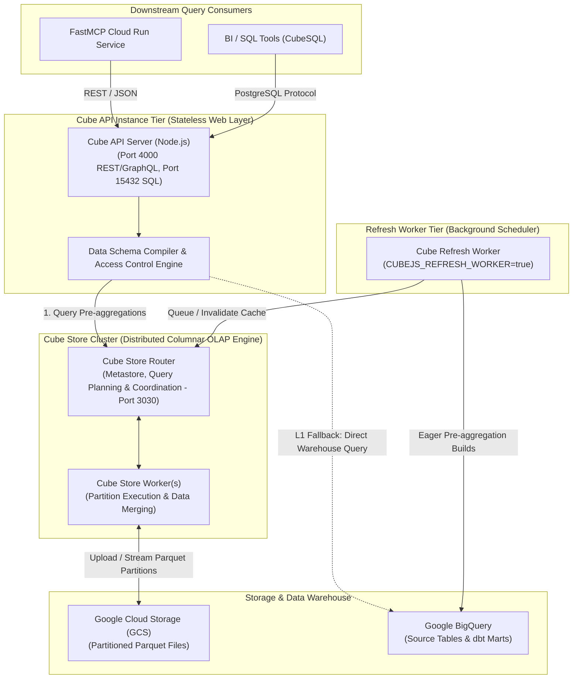
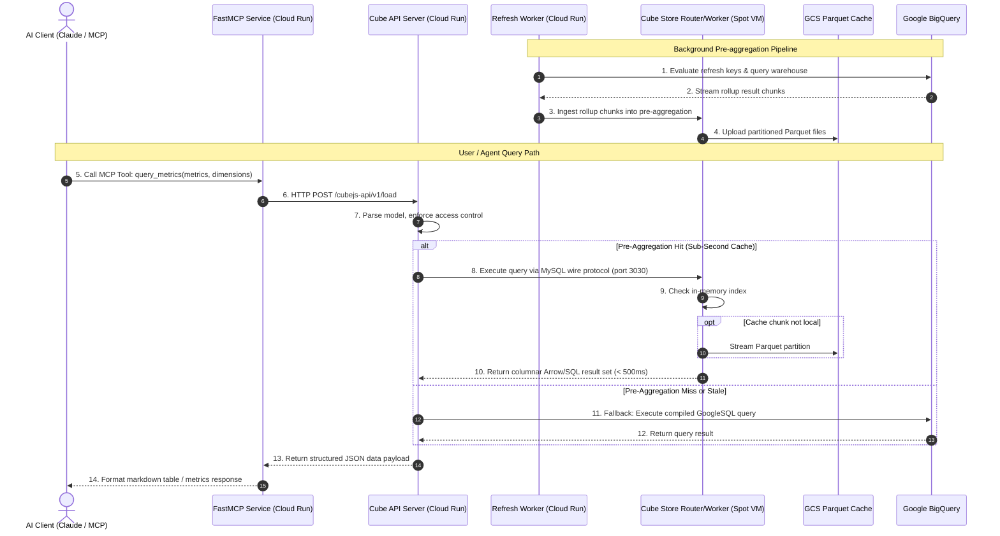

# Cube Core Architecture & Google Cloud Platform Resource Mapping

This document provides a technical overview of **Cube Core**, its internal engine components as defined in the [official Cube Core Architecture documentation](https://docs.cube.dev/cube-core/architecture), the query evaluation lifecycle, and how each component is instantiated on **Google Cloud Platform (GCP)** within this project.

---

## 1. Cube Core Architectural Components

According to the official Cube Core architecture, a production Cube deployment separates responsibilities across specialized, independently scalable components:

### Component Breakdown & Responsibilities

| Component | Official Role (docs.cube.dev) | Project Implementation | Key Responsibilities |
| :--- | :--- | :--- | :--- |
| **API Instances (Cube Server)** | Stateless web tier handling client requests | Cloud Run v2 (`cubedev/cube:v0.36.0`) | - Ingests REST, GraphQL, and CubeSQL requests. - Compiles data models (hydrated from dbt `manifest.json`). - Evaluates security context, tenant isolation, and row/column security. - Routes analytical queries to Cube Store or directly to BigQuery. |
| **Refresh Worker** | Dedicated background pre-aggregation builder | Cloud Run v2 (Job / Worker container with `CUBEJS_REFRESH_WORKER=true`) | - Decouples heavy pre-aggregation builds from API traffic. - Executes rollup queries against BigQuery on schedule or trigger. - Evicts stale pre-aggregations and updates refresh keys. - Eliminates CPU/memory contention on user-facing API instances. |
| **Cube Store: Router** | Metastore coordinator & query planner | Compute Engine Spot VM (Co-located in Standalone mode or separate Router) | - Maintains the metastore (schema, partitions, index tracking). - Plans incoming queries and coordinates query queues. - Lightweight coordinator; avoids heavy result merging to prevent blocking. |
| **Cube Store: Worker(s)** | Distributed execution engine | Compute Engine Spot VM (Worker process) | - Owns specific data partitions using consistent hashing. - Executes partial queries against columnar chunks. - Uploads and streams Parquet data to/from cloud object storage. |
| **Remote Object Store** | Scalable, shared persistent storage | Google Cloud Storage (`${project_id}-cube-store-cache`) | - Durable storage for pre-aggregated Parquet tables. - Decouples compute from storage, enabling workers to be ephemeral/Spot. |
| **Data Warehouse** | System of record / source of truth | Google BigQuery (`analytics` and `thelook_ecommerce`) | - Executes underlying warehouse queries and source rollup scans. |

---

## 2. Google Cloud Platform Resource Mapping

To achieve maximum cost efficiency and horizontal scalability on GCP, the architectural components are mapped as follows:

| Logical Component | GCP Resource | Configuration & Sizing | Networking & Access Controls | Cost & Reliability Rationale |
| :--- | :--- | :--- | :--- | :--- |
| **Cube API Server** | **Cloud Run v2 Service** | - Container: `cubedev/cube:v0.36.0` - CPU: 1 vCPU, Memory: 2 GiB - Scaling: 0 to 5 instances (`min-instances = 0`) | - Direct VPC Egress (`private-ranges-only`) - IAM: `cloud-run-cube-sa` - Internal Ingress from FastMCP | Scales to zero when idle; handles bursts automatically during active agent conversations. |
| **Cube Refresh Worker** | **Cloud Run v2 Service / Cloud Run Job** | - Container: `cubedev/cube:v0.36.0` - Env: `CUBEJS_REFRESH_WORKER=true` - Sizing: 1 vCPU, 2 GiB | - Direct VPC Egress to Cube Store - IAM: `cloud-run-cube-sa` | Isolates background rollup builds so that heavy BigQuery scans do not impact API latency or cause out-of-memory errors on API nodes. |
| **Cube Store Engine** | **Compute Engine Spot VM** in a Managed Instance Group (MIG) | - Container: `cubedev/cube-store:v0.36.0` - Machine type: `e2-medium` (2 vCPU, 4 GiB RAM) - OS: Container-Optimized OS (COS) - Mode: Standalone (`CUBESTORE_SERVER_NAME=localhost:9999`) | - Private IP only (no public IP) - VPC Firewall: Port `3030` ingress restricted to Cloud Run subnet - IAM: `cube-store-sa` | Spot VMs provide a ~60-91% cost reduction. Because data is durably stored in GCS Parquet files, node preemptions cause zero data loss. |
| **Cube Store Parquet Store** | **Google Cloud Storage (GCS) Bucket** | - Name: `${project_id}-cube-store-cache` - Storage Class: `STANDARD` - Public Access: Enforced Uniform Bucket-Level Access | - Read/Write: `roles/storage.objectAdmin` to `cube-store-sa` - Zero public exposure | Persistent, decoupled storage ensuring state survives Spot VM preemptions and restarts. |
| **Network Bridge** | **Custom VPC + Direct VPC Egress** | - VPC: Custom regional subnet (`10.10.0.0/24`) - Direct VPC Egress on Cloud Run services | - Private transit between Cloud Run and Spot VM private IP on port `3030` | Eliminates Serverless VPC Access connector fees and prevents public internet egress for internal cache queries. |
| **Underlying Warehouse** | **Google BigQuery** | - Datasets: `thelook_ecommerce` (replicated raw data) and `analytics` (dbt mart views/tables) | - IAM: `roles/bigquery.jobUser` and `roles/bigquery.dataViewer` | Enterprise serverless data warehouse handling cold queries and initial rollup builds. |

---

## 3. Query & Refresh Lifecycle

---

## 4. Operational & Deployment Checklist

Following Cube's production checklist recommendations:

1. **Disable Development Mode:**
   - Production API instances run with `CUBEJS_DEV_MODE=false` to enforce token authentication, block the dev playground, and prevent arbitrary SQL execution.
2. **Dedicated Background Processing:**
   - Pre-aggregations are built by a dedicated worker rather than user-facing API instances.
3. **Decoupled Columnar Cache:**
   - Standalone Cube Store backed by GCS Parquet persistence rather than in-process SQLite or local disk.
4. **Keyless Service Identity:**
   - Cloud Run and Compute Engine instances authenticate to GCS and BigQuery via Google Cloud IAM service account tokens (no static JSON keys).
5. **No Separate Reverse Proxy Required (Cloud Run Native Ingress & IAM):**
   - In traditional Docker/VM deployments, Cube recommends NGINX for HTTPS/TLS termination, HTTP/2, gzip compression, and rate limiting.
   - In our serverless GCP topology, **a separate reverse proxy (like NGINX) is unnecessary and omitted**:
     - The Cube API is **not** exposed to the public internet. Its Cloud Run ingress is configured to `internal` (`--ingress=internal`).
     - Only the FastMCP Cloud Run service calls the Cube API over Google Cloud's private software-defined network.
     - Cloud Run provides managed TLS termination, HTTP/2 multiplexing, automatic DDoS protection, and fine-grained IAM authentication (`roles/run.invoker`) out of the box with zero proxy infrastructure maintenance.
