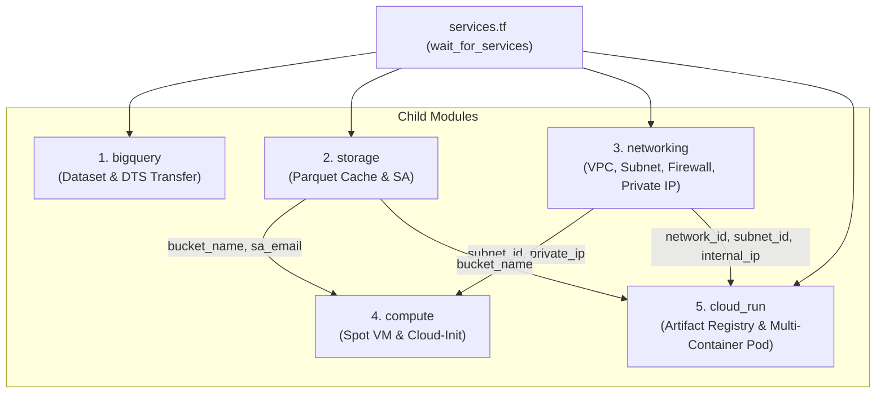

# Terraform Infrastructure Modules Reference

This document provides a consolidated reference specification for all reusable Terraform child modules defined under [`terraform/modules/`](file:///home/angelo/projects/cube-core-mcp/terraform/modules/).

---

## 1. Module Overview & Dependency Graph

---

## 2. Module: `bigquery` ([terraform/modules/bigquery/](file:///home/angelo/projects/cube-core-mcp/terraform/modules/bigquery/))

### Purpose
Provisions BigQuery datasets (`thelook_ecommerce` and `analytics`), configures the BigQuery Data Transfer Service (DTS) service account, and schedules automated copying of public eCommerce sample data.

### Inputs
| Name | Type | Required | Description |
| :--- | :--- | :--- | :--- |
| `project_id` | `string` | Yes | Target Google Cloud Project ID. |
| `region` | `string` | Yes | Regional location for BigQuery datasets (default `asia-south1`). |
| `environment` | `string` | No | Deployment tier label (`dev`, `staging`, `prod`). |
| `services_dependency` | `any` | Yes | Explicit dependency on `time_sleep.wait_for_services`. |

### Outputs
| Name | Description |
| :--- | :--- |
| `thelook_dataset_id` | ID of the ingested raw `thelook_ecommerce` dataset. |
| `analytics_dataset_id` | ID of the curated `analytics` reporting dataset. |
| `dts_service_account_email` | Service account used by BigQuery Data Transfer Service. |

---

## 3. Module: `storage` ([terraform/modules/storage/](file:///home/angelo/projects/cube-core-mcp/terraform/modules/storage/))

### Purpose
Provisions the regional Google Cloud Storage bucket for decoupled Cube Store Parquet pre-aggregations (`gs://${project_id}-cube-store-cache`) and the dedicated `cube-store-sa` service account.

### Inputs
| Name | Type | Required | Description |
| :--- | :--- | :--- | :--- |
| `project_id` | `string` | Yes | Target Google Cloud Project ID. |
| `region` | `string` | Yes | Bucket regional location (`asia-south1`). |
| `environment` | `string` | No | Deployment tier label. |
| `services_dependency` | `any` | Yes | Explicit dependency on API propagation. |

### Outputs
| Name | Description |
| :--- | :--- |
| `bucket_name` | Name of the GCS cache bucket. |
| `bucket_url` | Full `gs://` URI of the cache bucket. |
| `service_account_email` | Email address of `cube-store-sa@`. |

---

## 4. Module: `networking` ([terraform/modules/networking/](file:///home/angelo/projects/cube-core-mcp/terraform/modules/networking/))

### Purpose
Provisions the custom-mode VPC (`cube-network`), regional subnet (`cube-subnet`, `10.10.0.0/24`) with Private Google Access enabled, internal firewall rules (allowing ports 3030, 9999, and IAP SSH port 22), and reserves the static internal private IP `10.10.0.10`.

> [!NOTE]
> Cloud NAT was intentionally decommissioned from this module in favor of pulling container images directly from Artifact Registry via Private Google Access, eliminating ~$32.40/month in baseline network fees ([ADR-0005](file:///home/angelo/projects/cube-core-mcp/docs/architecture/adrs/0005_artifact_registry_mirroring_vs_cloud_nat.md)).

### Inputs
| Name | Type | Default | Description |
| :--- | :--- | :--- | :--- |
| `project_id` | `string` | - | Target Google Cloud Project ID. |
| `region` | `string` | - | Network region (`asia-south1`). |
| `subnet_cidr` | `string` | `10.10.0.0/24` | Primary CIDR block for the private subnet. |
| `cube_store_private_ip` | `string` | `10.10.0.10` | Static internal IP reserved for Cube Store. |
| `environment` | `string` | `dev` | Environment label. |
| `services_dependency` | `any` | - | API activation timer dependency. |

### Outputs
| Name | Description |
| :--- | :--- |
| `network_id` | Resource URI of the VPC network. |
| `network_name` | Name of the VPC network (`cube-network`). |
| `subnet_id` | Resource URI of the private regional subnet. |
| `cube_store_internal_ip` | Deterministic private IP (`10.10.0.10`). |

---

## 5. Module: `compute` ([terraform/modules/compute/](file:///home/angelo/projects/cube-core-mcp/terraform/modules/compute/))

### Purpose
Deploys the ephemeral Compute Engine Spot VM running Container-Optimized OS (COS), configured via declarative `cloud-init` metadata that registers Cube Store as a managed `systemd` service with automatic restart supervision ([ADR-0002](file:///home/angelo/projects/cube-core-mcp/docs/architecture/adrs/0002_why_systemd_supervises_cube_store_on_cos.md)).

### Inputs
| Name | Type | Default | Description |
| :--- | :--- | :--- | :--- |
| `project_id` | `string` | - | Target Google Cloud Project ID. |
| `region` | `string` | - | Cloud region. |
| `zone` | `string` | - | Target zone (`asia-south1-c`). |
| `enabled` | `bool` | `true` | Feature switch to provision or tear down the Spot VM. |
| `machine_type` | `string` | `e2-small` | Machine sizing for the cache node. |
| `boot_disk_size_gb` | `number` | `10` | Boot disk size in GB (COS minimum). |
| `subnet_id` | `string` | - | Subnet resource URI from the networking module. |
| `cube_store_private_ip` | `string` | - | Static private IP (`10.10.0.10`). |
| `cube_store_sa_email` | `string` | - | Service account email (`cube-store-sa@`). |
| `cube_store_bucket_name` | `string` | - | GCS cache bucket name. |
| `cube_store_image` | `string` | - | Full path to mirrored Artifact Registry image. |

### Outputs
| Name | Description |
| :--- | :--- |
| `instance_name` | Name of the compute instance (`cube-store`). |
| `instance_id` | Unique instance ID. |

---

## 6. Module: `cloud_run` ([terraform/modules/cloud_run/main.tf](file:///home/angelo/projects/cube-core-mcp/terraform/modules/cloud_run/main.tf))

### Purpose
Provisions the Google Artifact Registry Docker repository (`cube-repo`), the unified workload runtime Service Account (`cloud-run-cube-sa`), Google Secret Manager secrets for Google OAuth 2.0 credentials, and the multi-container **Cloud Run v2 service** containing the FastMCP ingress container and Cube Core sidecar ([ADR-0004](file:///home/angelo/projects/cube-core-mcp/docs/architecture/adrs/0004_multi_container_pod_vs_separate_services.md)).

### Inputs
| Name | Type | Default | Description |
| :--- | :--- | :--- | :--- |
| `project_id` | `string` | - | Serving infrastructure GCP project. |
| `reporting_project_id` | `string` | `""` | Optional external BigQuery project for cross-project federation. |
| `reporting_dataset_id` | `string` | `"analytics"` | Target reporting dataset containing fact and dimension tables. |
| `region` | `string` | - | Serving region (`asia-south1`). |
| `enabled` | `bool` | `true` | Toggle switch to deploy or pause the Cloud Run service. |
| `network_id` | `string` | - | VPC network URI for Direct VPC Egress. |
| `subnet_id` | `string` | - | Subnet URI for Direct VPC Egress. |
| `cube_store_host` | `string` | `""` | Private IP of the Spot VM (`10.10.0.10`). |
| `cube_store_bucket_name` | `string` | `""` | Name of the GCS cache bucket. |
| `google_auth_enabled` | `bool` | `false` | Whether to enforce Google OAuth 2.0. |
| `fastmcp_transport` | `string` | `"streamable-http"` | MCP transport protocol (`streamable-http` or `sse`). |
| `invoker_members` | `list(string)` | `["allUsers"]` | IAM principals permitted to invoke the service. |

### Outputs
| Name | Description |
| :--- | :--- |
| `service_uri` | Public HTTPS endpoint of the FastMCP service. |
| `service_account_email` | Runtime identity (`cloud-run-cube-sa@`). |
| `artifact_registry_repository` | Name of the Docker repository. |
